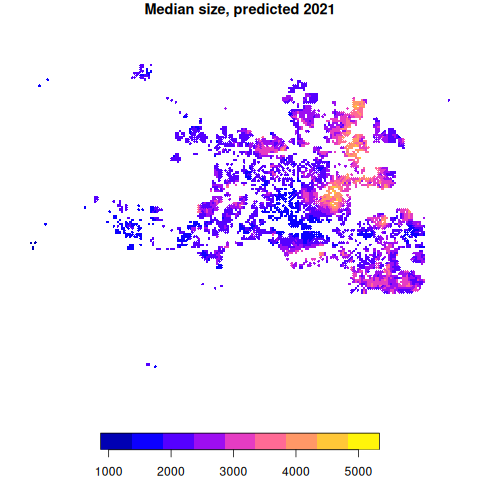
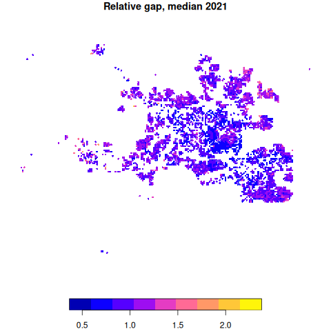
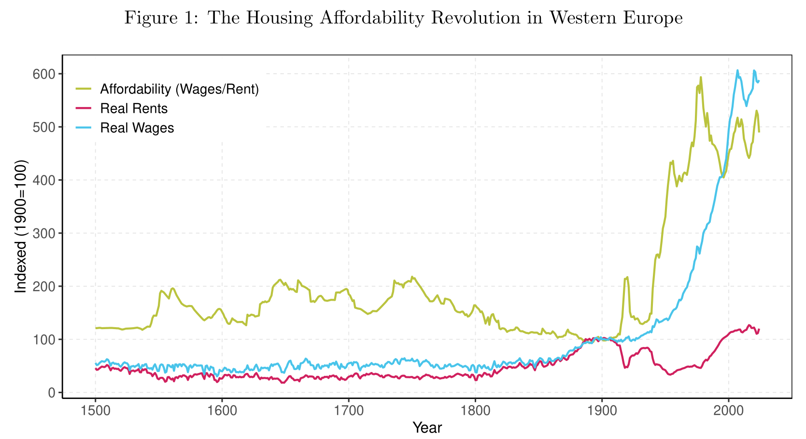

The global financial crisis of 2008/2009 has highlighted the pivotal role of real estate in our
economy and financial system once more. The sheer size of the asset class dominates national
accounts and household-level balance sheets alike, both in terms of assets and liabilities.
 
To be able to make better-informed decisions, academia, industry, policymakers and private
households should be familiar with real estate’s risk–return profile. After all, housing accounts
for nearly half of the total assets of UK households. Still, property investments are often
misunderstood as being fundamentally different from more mainstream asset classes such as
stocks or bonds. Simplistic advice such as “Buy land, they’re not making it anymore”, attributed
to Mark Twain (there is no evidence of this provenance), is typical for a view in which real estate is exceptional: returns exceed a fair
compensation for risk. Recent academic work – incorrectly – supports this view. A suggested “risk premium puzzle for housing
investments” <a href="https://doi.org/10.1093/rfs/hhab042">is not in line with theory and can be traced back to data shortcomings.</a>

In my research, I strive for more realistic estimates of real estate’s risks and returns, both at the market and at the asset level. 
To do so, I combine theory and data, traditional econometrics and innovative machine learning techniques, <a href="https://papers.ssrn.com/sol3/papers.cfm?abstract_id=3418495">dusty archives</a> and <a href="http://onlinelibrary.wiley.com/doi/10.1111/1540-6229.12204/abstract">big data sensors</a>. I <a href="https://doi.org/10.1111/1540-6229.12416'">explore applied machine learning techniques</a> to utilise high-dimensional and often “Big(ish)” data. Put differently, I <a href="https://link.springer.com/article/10.1007/s11146-021-09845-1">use images</a> and <a href="http://www.sciencedirect.com/science/article/pii/B9780124095489096822">other data that are too complex for spreadsheets</a> to better understand property values, <a href="http://dx.doi.org/10.2139/ssrn.4923052">fund returns</a>, <a href="http://www.sciencedirect.com/science/article/pii/S1051137714000321">household preferences</a> and decisions made by very human and not always rational agents.

## All Published work

All publications can be found <a href="/publications/">here</a>.

## Work in Progress

### Technology and Real Estate

* Lindenthal, T.; Kalikman, P. and D. Ruf. **"How AI Shapes the Research Agenda in Real Estate Finance and Economics"**
  - Large language models carry their own view of what a field is, and that view does not fully match what the field's literature contains. We map the published record of real estate finance and economics into a semantic embedding space and evaluate 3,200 AI-generated research proposals across eight prompting conditions. On atypicality, a measure of cross-community recombination, AI proposals are comparable to published work. Without corpus context, however, they cluster around a narrow set of topics (natural-disaster and climate risk, rent control, property tax, mortgage lending discrimination), while mortgage finance and institutional real estate barely register. The same pull shows up in the references the model reaches for. Supplying the published corpus widens the spread but does not straightforwardly fix it.

* Lindenthal, T. <a href="https://papers.ssrn.com/sol3/papers.cfm?abstract_id=7569478">**"Real Estate Derivatives at Last? Prediction Markets as Forecasts, Not Hedges"**</a>
  - LIVING PAPER, UPDATED QUARTERLY AT <a href="https://living.pub">LIVING.PUB</a>. Exchanges have listed derivatives on property prices since 1991, and none has become liquid. Event contracts on prediction markets are the latest attempt. Using all real estate contracts listed on Kalshi and the house price contracts on Polymarket, I ask whether they remove the obstacles that stopped earlier property derivatives. They do not. The contracts are quoted as tightly and priced as accurately as other economics contracts, so they work as forecasts, but they barely trade and they do not transfer risk. Repeat sales from Cook County show that an index hedge removes almost none of an owner's price risk over short holding periods, no contract runs long enough to matter, and the order books are too thin to hedge even a single home.

* Lindenthal, T. **"Social Class, Ethnicity and Migration Status in AI Housing Advice in the United Kingdom"**
  - EARLY DRAFT. People increasingly ask large language models where to live and whether to buy or rent. An adviser that sends otherwise identical customers to different neighbourhoods because of who they are practises steering. I audit LLM housing advice in Birmingham, Manchester and London, signalling class of origin, ethnicity and migration status through synthetic CVs while holding finances and housing needs fixed. Outcomes are the deprivation of the recommended neighbourhoods and the advice to rent or to buy. Because models often recognise bias audits as tests, and tests prompt more even-handed answers, I also measure how often they do so and use this to interpret the results.

### Other Projects

* Leow, K. and T. Lindenthal. <a href='/assets/papers/Leow-Lindenthal-Leveraging-Missing-Data-in-Commercial-Real-Estate.pdf'>**”Machine Learning and Missing Data in Real Estate”**</a>
  - NEW WORKING PAPER, FEEDBACK MUCH APPRECIATED. Real estate research tends to be plagued by missing data. We show that prediction accuracy can increase by incorporating observations with missing predictors in the case of commercial real estate. We also show that missing data may not be occurring at random, which makes it more important to incorporate all observations into a prediction model, be it complete or not. Finally, we show that when one incorporates missing data into training sets, prediction outcomes can go into opposite direction

 
* Clapp, J.; Nichols, J., and T. Lindenthal. **“Rebuilding the City Inside and Out: Supply Kinks and Quantities”**
  - We study intensive and extensive margins of housing supply over time and neighborhoods within a metropolitan area as a function of the existing built environment characterized. We ground our approach with an innovative durable capital model where we use inverse demand functions to generate implications for changes in housing supply instead of prices, suggesting substantial differences in dynamics across the two supply margins. This allows us to expand our empirical work to include all properties in our 14 years of Maricopa County property assessments, not just those that transact. We also innovate by estimating a machine learning model of the level of the optimal size of a residential home at all parcels, both those currently with residential properties and those without. This allows to empirically estimate the probability of a housing supply increase and the conditional size of the increase separately for each margin. Consistent with our model, the impact of the optimal home size on the extensive margin is significant, positive, and largely linear, while the impact of the gap between the optimal home size and the size of an existing home has a pronounced kink. 
<table>
    <tr>
        <td>Predicted Int. Floor Space (sqft) </td>
        <td>Gap: Pred. space - current space </td>
    </tr>
</table>

* Korevaar, M.; P. Eichholtz, P. and T. Lindenthal. <a class="external-link" href="https://papers.ssrn.com/sol3/papers.cfm?abstract_id=3418495" target="_self" title="">**“A Housing Affordability Revolution?”**</a>
    - We study housing affordability in seven European cities from 1500-2024, using nearly half a million rent observations linked to wages, quality, and inequality. Constant-quality real rents rose slowly, while housing quality improved substantially. The 1910s-1970s saw a "housing affordability revolution," with rapid wage growth relative to rents, declining inequality, and large-scale housing policies. Yet expenditure shares increased, particularly among low-income households. We use a Stone--Geary framework to reconcile these facts: rising minimum housing standards steepen Engel curves, raising budget shares at the bottom even when rent-to-wage affordability improves. Prices are an incomplete guide to affordability when housing standards evolve. 
    

    
* Lindenthal T. and P. Eichholtz. **“That’s What We Paid for It: The Spell of the Home Purchase Price through the Centuries”**

