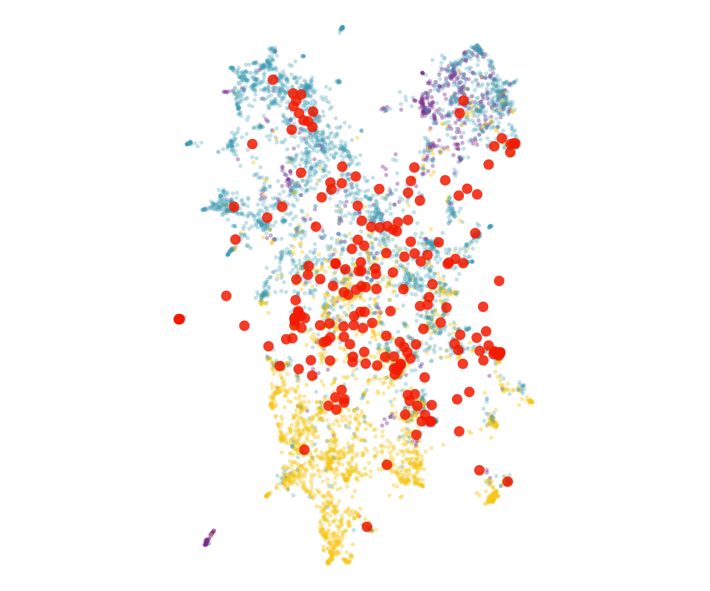
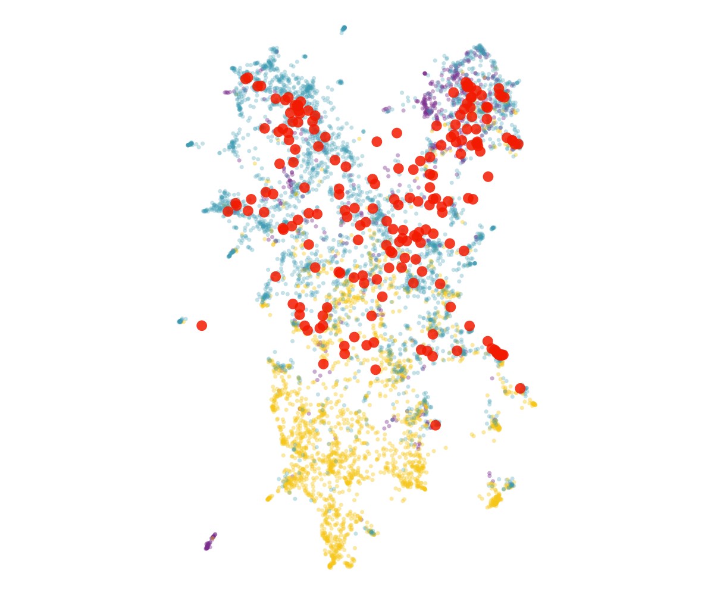

*Updated 23 November 2026. The paper, now with Philip Kalikman and Daniel Ruf, has a larger idea set, more journals and a cross-model check, and some of the earlier conclusions have changed. The original April version of this post described 1,499 ideas and an atypicality score that predicted citations; that result did not survive.*

AI is everywhere in academic research. Kobak et al. (2025, *Science Advances*) tracked words that language models overuse — "delve," "nuanced," "meticulous" — across 14 million biomedical abstracts and found at least 13.5% of 2024 papers were processed by an LLM. The same pattern shows up in the real estate literature, as a [quick replication on 100K real estate papers indexed by OpenAlex](https://www.lindenthal.eu/talks/talk-ai-re-research/#/2) shows.

That is the writing layer in the research process. The more consequential shift is deeper. A growing number of papers rely on AI not for drafting but for execution — work that could not exist without machine learning carrying out the core analysis. [Bartik, Gupta and Milo (2025)](https://doi.org/10.1257/jep.20241428) read thousands of municipal zoning codes and built regulation measures that no research team could produce by hand. [Calainho, van de Minne and Francke (2024)](https://doi.org/10.1111/1540-6229.12494) replaced linear hedonic models with ML on 30,000 New York transactions and showed systematic gains in out-of-sample accuracy. [Shen and Ross (2021)](https://doi.org/10.1016/j.jue.2020.103299) extracted a description-quality measure from MLS listing text that captures soft information about property quality invisible to structured data. [Leow and Lindenthal (2025)](https://doi.org/10.1111/1540-6229.12527) applied the Gu-Kelly-Xiu ML asset-pricing framework to REIT factor returns and showed substantial forecast improvements over OLS.

In each case, AI enables a measurement or prediction the research requires. Remove it and the paper disappears. But the role is still that of a skilled research assistant (RA): executing tasks specified by a human. The principal investigator (PI) — the person deciding what to study and why — remains human.

  
Core research competencies: AI vs human (self-assessment)

  <canvas id="radar-chart" style="width:100%; max-height:420px;"></canvas>

AI outperforms human researcher in many dimensions (speaking for myself, obviously). The question is whether it can shine higher up the value chain. Can LLMs suggest research topics that are genuinely innovative and plausibly doable — functioning more as a PI than as an RA? Do humans still have a competitive edge?

The working paper, now titled *"How AI Shapes the Research Agenda in Real Estate Finance and Economics"*, tests this. We mapped the published record of *Real Estate Economics*, the *Journal of Real Estate Finance and Economics* and the *Journal of Real Estate Research*, along with real-estate-relevant papers from the *Journal of Urban Economics* and selected economics, finance and psychology papers, into a shared semantic embedding space. An LLM extracts each paper's research question, method and data, and these are embedded and clustered into research strands. The result is a coordinate system for the field: not a literature review, but a map.

Against that map, we generated 3,200 research proposals under eight conditions, each run eight times with no memory of the other runs. The conditions vary the context the model receives: nothing at all, a topic list, the full REE corpus with and without that list, or methods and paradigms to transfer from economics and finance or from psychology. Each condition also runs in a version where the model must confirm that the data it needs actually exists.

The figure below shows where the proposals land. Red dots are AI proposals; the background is the published corpus. On the left is naïve generation, with no context at all. On the right is method transfer from economics and finance.

  <figure style="margin:0; text-align:center; max-width:340px;">
    
    <figcaption style="font-size:0.8em; color:#555; margin-top:0.4em;">A: Naïve — no context provided</figcaption>
  </figure>
  <figure style="margin:0; text-align:center; max-width:340px;">
    
    <figcaption style="font-size:0.8em; color:#555; margin-top:0.4em;">C: Method transfer from economics &amp; finance</figcaption>
  </figure>

On atypicality, a measure of how unusually a paper combines strands of the literature, the best proposals match published REE papers. Proposals that transfer methods from economics and finance score highest, and naïve generation scores lowest. A few are combinations that, as far as we can tell, nobody has tried. Some rediscover questions the field answered twenty years ago, but so do human proposals. The caveat is that atypicality turns out not to predict citations in the published corpus: venue and topic do. It is measurable but unvalidated. Six real estate economists are now rating a blind sample of proposals mixed with published papers.

The more interesting finding concerns where the proposals go. Without corpus context, the model's idea of real estate economics gravitates toward natural-disaster and climate risk, rent control, property tax and mortgage lending discrimination, while mortgage finance, capital markets and institutional real estate barely register. This is not just one model: GPT-5 and Gemini 3.1 Pro lead with the same two topics in the same order. Supplying the published corpus widens the spread, but it redirects the model only when nothing else in the prompt anchors the output. Every condition is more concentrated than the field itself.

The same pull shows up in citations. Asked which papers it would cite for its own proposals, the model reaches for a small canon from general-interest economics and finance journals. *Real Estate Economics* ranks ninth among the journals it names, even though every proposal is a real estate question.

A built-in prior is not harmful in itself, and the clusters the model favours have been gaining citations for a decade, so the models may be inheriting an emphasis the field built on its own. But scientific attention is path dependent. If a growing share of ideation and literature review runs through these systems, a small, undirected bias could compound. It would not be a revolution in how science is done but a slow, gravitational pull on what gets proposed, cited and published. Over time, this will steer the literature into fewer "popular/lucrative/promising" topics and reduce the diversity in research directions. **Like it or loathe it, AI systems shape our collective research.**
